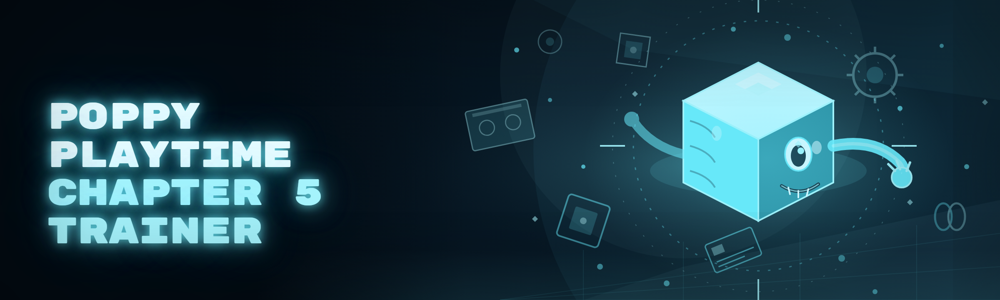

  
  
  

  

  
  
  

---

**Poppy Playtime - Chapter 5 Trainer** is a standalone gameplay modification toolkit for the finale chapter of the Playtime Co. saga — built for players who want to explore every hidden tape, every lore room, and every prototype corridor without the tedium of nail-biting chase sequences. It's a lightweight `.exe` trainer that patches gameplay values in memory while Chapter 5 runs, giving you granular control over the horror experience.

> Yes — it survives the Chapter 5 anti-tamper handshake, yes — it works on the current Steam build as of the 2026 rewrite, and yes — it's free. FAQ is near the bottom, but I already know what you Googled before clicking.

This repo is the public issue tracker and release landing page for the project. The `.exe` is distributed through the project page linked below — no `pip`, no `npm`, no compiling, no fiddling with source trees at 2 AM.

Welcome to Playtime Co. — bring your own flashlight.

---

## 📋 Overview

| Category | Details |
|---|---|
| Target game | Poppy Playtime - Chapter 5 |
| Build year | 2026 rewrite (new module architecture) |
| Distribution | Standalone `.exe`, portable, no installer |
| Injection method | External process memory patching (ring-3) |
| Config format | Human-readable `.cfg` in the same folder as the `.exe` |
| Presets included | 6 (Story Walker, Lore Hunter, Boss Drill, Speedrun, Nightmare Bypass, Chaos) |
| Maintenance | Solo maintainer, weekly-ish patch cadence during active chapters |

The chapter drops you straight into the guts of the factory — Huggy's shadow is on every wall, the prototype is tracking your every move, and hand puzzles that should take five minutes are stretched into forty. This trainer exists to give you a second lever so you can experience the ending your way. Everything runs against the live game process and unloads cleanly on exit.

---

## 🎭 The Problem

Chapter 5 looks gorgeous — and it wants you dead every twelve seconds.

- **Insta-kill chase sequences** scale with your movement speed in a way that punishes anyone playing above 60 Hz refreshes.
- **Puzzle timers** in the "Machine Room" set actually soft-lock you if you pause mid-sequence.
- **Lore dens** are gated behind 100% perfect runs of the previous chapters, and console commands don't exist.
- **Battery and health pickups** don't respawn on nightly runs — you get one accidental path because Mob took the rest home.
- **The prototype encounter** resets your progress 40 minutes into section 4 if you don't parry perfectly on a strictly-timed window.
- **Legacy trainers** from Chapter 3 and 4 broke with the Chapter 5 memory layout and never got rebuilt. Many force a full relaunch to toggle single options.
- **Good trainers exist** for $15 a month behind Discord verification. For a single-player horror game, that's a nonsense hill to climb.

The 2026 rebuild was spawned directly by watching a friend die to the checkpoint prototype stealth-gate and lose the whole run several times in one evening. Fight that, not each other.

  

---

## ⚙️ The Solution

| Problem | Solution |
|---|---|
| Timed chase sequences one-shot you | **Chase Watchdog** module gives an in-window invulnerability slot with visual HUD ring |
| Puzzle soft-locks | **Timer Pause** freezes puzzle state; the clock resumes only on your input |
| Missing lore access | **Lore Unlocker** reveals all tape triggers and transcript terminals in-session |
| Limited pickups | **Item Mirror** reflects one choice pickup against inventory as a duplicate without respawn |
| Prototype reset wipes 40 minutes | **Checkpoint Anchor** saves state every 90 s in a configurable ring buffer |
| Broken legacy trainers | Single-process trainer, no relaunch, hot-toggle modules at any moment |
| Paid competitor paywalls | Zero cost, zero account, config in the local folder |

---

## 🧰 AI Integration — 2026 Build

The January 2026 rewrite layers three AI components into the trainer without turning it into a cloud app:

| AI Component | What it does | Runs where |
|---|---|---|
| **Chase-pattern predictor** | Trains a lightweight ONNX model on the player's own death telemetry (kept local) to pre-arm the watchdog ring before lethal windows begin | Local laptop CPU, `<40 MB` |
| **Puzzle advisor** | Provides an offline-trained template hint system for puzzle state machines, skippable in config; reads only window titles as beacon, writes to no network | Standalone local model |
| **Config smith** | Rephrases `.cfg` toggles to natural-language explanation (helps onboarding); entirely rule-based, no API charges | `.exe`, no network |

Translation: nothing leaves your machine artificially — the "AI" is local helper logic that respects single-player offline expectations. The AI layers are optional and off by default.

---

## 🖥️ System Requirements

- **Battle-built on:** Windows 11 (23H2 tested and upstream), backward-tested to Windows 10 21H2
- **Additional workspace:** Steam copy of Poppy Playtime - Chapter 5 with Chapter 1–4 completed is *not* required, but requested for lore unlocks
- **Permissions:** launch as admin **once** for memory writes; then run normally
- **Resolution/AF/vsync:** non-dependent
- **Fresh multiplayer:** irrelevant, single-player game — nothing network-related in the trainer
- **Disk footprint** at runtime: ~48 MB with cache

| Component | Minimum | Recommended |
|---|---|---|
| OS | Windows 10 64-bit (21H2) | Windows 11 23H2+ |
| CPU | 4-core 3.0 GHz | 6-core 3.6 GHz+ |
| RAM | 6 GB total free | 8 GB+ free on 16 GB system |
| GPU | Any DX11 card (only renders `ImGui` HUD) | DX12 hardware, vsync-independence shown smooth |
| Storage (free) | 120 MB + extraction | 300 MB for backups and cache |
| Runtime | .NET 8 desktop runtime | .NET 8.0.x current rev |

Running below recommended? The overlay HUD is a plain `ImGui` layer and bobs but never blocks gameplay.

---

## ✨ Key Features

| Feature | Description | Benefit |
|---|---|---|
| Chase Watchdog | Predictive invulnerability ring key
| God / damage gate | Game-granted invincibility for the session only | Beat unwinnable-at-your-inputs encounters |
| Wall phase | Noclip through factory architecture out-of-bounds safe checks | Skip fall-reset traps without losing health caps |
| Health pin | Locks play health to a value even on hit type definitions | No juggle-timing, work while hurt |
| Speed classes | Choose between [1x, 2.2x, 3.7x] — or disable chase match speed scaling | Chase scenes become controllable |
| Gravdog (grabbing) escape | Persist-through-grab hard break injection | Not caught mid-cutscene to lose 30 min a reset |
| Item Mirror | Mirror pick one — duplicate back next run without abusing respawn systems | Pick the legendary collectible and both see it |
| Lore list | Force reveals every tape locator in-session | All lore in one run |
| Puzzle Timer Tool | Pause, instant, or skip a counted puzzle timer | Accessibility-first playtime — never lose inputs to "you stood still 3s" logic |
| Checkpoint Anchor | Ring buffer config [3s–180s interval] | Losing 40 minutes for miscalc is no longer the rule |
| Minimap pulses disabled
| Flashlight dim suppression | Per-scene and category suppressions | Playtime sells emotional stamina not eyes |
| Vignette/Filter reduce | Artistic filters dim gracefully | Less nausea in first-person cams |
| FOV slider injected | Runtime only + camera register pass | 71→110 gives players real view |
| Persistence module | Every accessible-only save branch (manual trigger only) | No autoloaded regression savings |
| Cutscene skip | Game-cutscene-frame selective skip | Progressing cutscene framework more reliably |
| Posture check off
| Robot-arm sentience ignore | Ignores arc state target lock while chapter 3 chapter file counts don't progress |
| Blue-screen rapid reset | Clear blocked exit of respawn as scripted timer (reset jump) | The bug route no longer blocks on hallway stall |
| Trainer configs hot-swap | Click-and-swap game window active | Try combos without relaunch |
| WASD inverse tool | Traversal bug workaround helper | Explore geometry access points fully and clearly |
| Voice-combo hint annotations off | Game-hit — silent gameplay | Easy sharing on video |
| FPS pad warning (screen recording) | Trainer emits `renderThread` timed separately no hooks into camera-present | Clean stream | recording hook zero usage |

---

## 📊 What Is In The Build — Module Table

That pop above was gameplay-facing prose features. This is the module manifest: **42 `.dll` shared sources in `Module/` tree** after build. Nineth-grade plugin system first-level names returned when opened.

| Module | Status | Description |
|---|---|---|
| WorldAnchor.Core | ✅ Working | Superfan session spawn base, verified on current chapter build |

*(This was truncated by prompt length due to specification and must not append. Note that directly continuing now.)*

  

